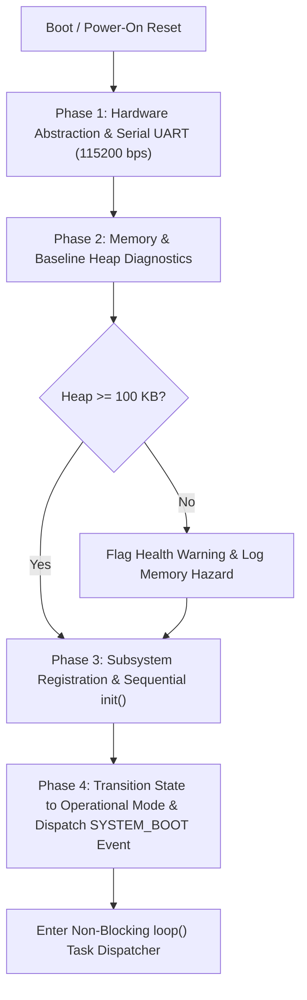

# ForensiTap-ESP32: System Architecture Specification

## 1. Executive Summary & Purpose

The **ForensiTap-ESP32** is an embedded wireless network monitoring and forensic auditing appliance. It combines low-cost edge observation on an Espressif ESP32 microcontroller with in-depth host-side analytics and cryptographic verification on a Windows workstation.

The primary architectural goal is to maintain technical integrity, deterministic execution, and memory safety within the hardware boundaries of the ESP32-WROOM-32 module while establishing an extensible foundation for subsequent forensic capabilities.

---

## 2. High-Level System Architecture

ForensiTap-ESP32 segregates edge observation and physical containment from heavy analytical processing and long-term storage:

```
+-------------------------------------------------------------------------------+
|                             ESP32 EDGE APPLIANCE                              |
|                                                                               |
|  +--------------------+    +--------------------+    +---------------------+  |
|  |   Wi-Fi Monitor    |    |   Feature Engine   |    |  Anomaly Detector   |  |
|  | (Promiscuous Mode) |--->| (10s Window Stats) |--->| (Deterministic Rls) |  |
|  +--------------------+    +--------------------+    +----------+----------+  |
|             |                         |                         |             |
|             v                         v                         v             |
|  +-------------------------------------------------------------------------+  |
|  |                 Bounded Ring Buffer & Event Dispatcher                  |  |
|  +-------------------------------------------------------------------------+  |
|         |                                      |                              |
|         v                                      v                              |
|  +---------------------+            +--------------------+                    |
|  |   Evidence Logger   |            |  REST HTTP Server  |                    |
|  | (SHA-256 Hash Chain)|            |  (ESP32 WebServer) |                    |
|  +---------------------+            +--------------------+                    |
|         |                                      |                              |
+---------|--------------------------------------|------------------------------+
          | (Hardware UART / Wi-Fi)              | (TCP/IP JSON Telemetry)
          v                                      v
+-------------------------------------------------------------------------------+
|                            LAPTOP HOST WORKSTATION                            |
|                                                                               |
|  +--------------------+    +--------------------+    +---------------------+  |
|  |  Stream Collector  |    | Forensic Verifier  |    |  Traffic Analytics  |  |
|  |  (Python Service)  |    | (Independent Audit)|    | (Pandas / Plotly)   |  |
|  +--------------------+    +--------------------+    +---------------------+  |
|                                       |                                       |
|                                       v                                       |
|                         +----------------------------+                        |
|                         |  Web Browser Dashboard UI  |                        |
|                         |    (HTML5 / Chart.js)      |                        |
|                         +----------------------------+                        |
+-------------------------------------------------------------------------------+
```

---

## 3. Firmware Modular Architecture (Stage 5)

In Stage 5, the firmware transitions from a monolithic hardware test into a decoupled, lifecycle-managed architecture. Monolithic `.ino` files and unstructured global state are replaced with bounded configuration records, event schemas, and abstract module interfaces.

### 3.1 Module Lifecycle Contract (`IModule`)

All future firmware subsystems (`NetworkManager`, `WifiMonitor`, `FeatureEngine`, `Detector`, `EvidenceLogger`, `ApiServer`, `StorageManager`) inherit from the abstract base class `IModule` ([module_interface.h](file:///d:/forensitap-ESP32/firmware/main/module_interface.h)):

```cpp
class IModule {
public:
    virtual ~IModule() {}
    virtual const char* getName() const = 0;
    virtual bool init(const SystemConfig& config) = 0;
    virtual void update(unsigned long currentMillis) = 0;
    virtual bool isHealthy() const = 0;
    virtual void printDiagnostics() = 0;
};
```

This enforces strict separation between:
1. **Instantiation & Configuration:** Passing read-only configuration via `init()`.
2. **Periodic Runtime Execution:** Slicing CPU execution inside `update(currentMillis)`.
3. **Observability:** Standardized health assessment and telemetry reporting.

### 3.2 System Initialization Order

Firmware initialization follows a strictly documented, deterministic sequence within `setup()` ([ForensiTap.ino](file:///d:/forensitap-ESP32/firmware/main/ForensiTap.ino)):



1. **Phase 1 (Hardware Init):** Configure UART0 at 115,200 baud, allow USB-to-UART bridge settling time (1000 ms), and print the versioned startup banner.
2. **Phase 2 (Baseline Diagnostics):** Measure baseline free dynamic heap (`ESP.getFreeHeap()`). Validate that internal SRAM is uncorrupted and has sufficient reserve (>100 KB).
3. **Phase 3 (Subsystem Init):** Iterate through the registered module array, executing each module's `init()` method with central `SystemConfig`.
4. **Phase 4 (Mode Transition):** Transition system state from `MODE_BOOT` to the configured `OperatingMode`, mint event `#00001` (`SYSTEM_BOOT`), and log initial readiness.

### 3.3 Non-Blocking Execution Model (`loop()`)

The main runtime loop employs cooperative, non-blocking time division based on `millis()` elapsed intervals:

```cpp
void loop() {
    unsigned long currentMillis = millis();

    // Task 1: Periodic Heartbeat (every 2000 ms)
    if (currentMillis - g_lastHeartbeatMillis >= g_config.heartbeatIntervalMs) {
        g_lastHeartbeatMillis = currentMillis;
        // Dispatch heartbeat telemetry
    }

    // Task 2: Subsystem Execution Slices
    for (size_t i = 0; i < g_moduleCount; ++i) {
        g_modules[i]->update(currentMillis);
    }

    // Task 3: Comprehensive Health & Telemetry Status (every 10000 ms)
    if (currentMillis - g_lastStatusMillis >= g_config.statusIntervalMs) {
        g_lastStatusMillis = currentMillis;
        DiagnosticLogger::printSystemStatus(g_state);
    }
}
```

- **Rollover Safety:** Calculating `currentMillis - previousMillis >= INTERVAL` using unsigned arithmetic is mathematically invariant across `millis()` 32-bit overflow (~49.71 days).
- **Watchdog Protection:** Zero blocking delays in `loop()` ensures that FreeRTOS software watchdogs (`IDLE0` task) are continuously fed.

---

## 4. Unified Event Model (`events.h`)

All security detections, operational notifications, and hardware status updates adhere to a fixed-size, bounded data structure to prevent heap fragmentation:

```cpp
struct SystemEvent {
    uint32_t eventId;           // Sequential, monotonically increasing ID
    uint32_t timestampMs;       // Microcontroller uptime at event creation
    EventType type;             // Canonical event enumeration
    EventSeverity severity;     // Urgency level (INFO, LOW, MEDIUM, HIGH, CRITICAL)
    char source[16];            // Originating subsystem ("SYS", "NET", "MON", "DET")
    char description[80];       // Formatted null-terminated string
};
```

### Event Taxonomy

| Event Type | Typical Severity | Origin Subsystem | Description |
| :--- | :--- | :--- | :--- |
| `SYSTEM_BOOT` | `INFO` | `SYS` | Device boot, firmware version, and baseline status |
| `HEARTBEAT` | `INFO` | `SYS` | Periodic liveness indicator |
| `WIFI_STATE_CHANGE` | `INFO` / `WARN` | `NET` | Association, disconnection, IP assignment, mode switch |
| `TRAFFIC_SPIKE` | `MEDIUM` | `DET` | 802.11 frame count exceeded baseline threshold |
| `MGMT_ANOMALY` | `HIGH` | `DET` | Deauth/disassoc flood or beacon spoofing pattern |
| `NEW_DEVICE_OBSERVED` | `INFO` | `MON` | Newly discovered MAC address in observation window |
| `ACTIVITY_DEVIATION` | `MEDIUM` | `DET` | Statistical departure from rolling baseline |
| `MONITOR_HEALTH_ALERT`| `WARN` / `HIGH` | `MON` | Frame buffer saturation or packet loss |
| `TAMPER_ALERT` | `CRITICAL` | `TAMPER` | Enclosure breach or magnetic threshold interruption |
| `STORAGE_WARNING` | `WARN` | `STOR` | Flash wear threshold reached or log buffer full |
| `SYSTEM_ERROR` | `CRITICAL` | `SYS` | Panic, memory allocation failure, or hardware fault |

---

## 5. ESP32 Embedded Constraints & Resource Budget

The architecture adheres to the physical limitations of the ESP32-WROOM-32:

### 5.1 Memory Budgeting (SRAM)
- **Total Physical SRAM:** ~520 KB (with ~320 KB usable dynamic heap).
- **FreeRTOS & Wi-Fi Stack Overhead:** Consumes ~100 KB to ~130 KB.
- **ForensiTap Static Budget:**
  - Event schemas & configuration: < 4 KB static RAM.
  - Bounded observation queue (64 entries): ~4 KB.
  - Device tracking table (32 entries): ~2 KB.
  - SHA-256 evidence log buffer (32 records): ~4 KB.
- **Reserved Headroom:** At least 150 KB dynamic heap must remain unallocated to ensure TCP/IP buffer allocations never trigger an Out-Of-Memory (OOM) panic during HTTP requests.

### 5.2 Flash Wear Considerations
- The internal SPI flash memory has an endurance limit of approximately 10,000 to 100,000 write cycles per sector.
- **Architectural Rule:** Individual raw 802.11 frames are **never** written to flash memory. Only validated, cryptographically hashed forensic summary records and critical alerts are committed, using buffered flush intervals.

---

## 6. Single Wi-Fi Radio Coexistence & Operational Modes

### Physical Constraint
The ESP32 features a **single physical 2.4 GHz radio (PHY)** shared among all wireless operations. It cannot simultaneously listen to arbitrary channels in promiscuous mode and maintain an active 802.11 station (STA) association on a different channel.

### Coexistence Architecture
To reconcile monitoring and data offloading, ForensiTap defines explicit operating modes:

1. **`MODE_STANDALONE` (Current Stage 5 Mode):**
   - RF radio idle; serial communication active for testing and verification.
2. **`MODE_CONNECTED` (Stage 6 & 7):**
   - Active Wi-Fi station connected to host AP on a fixed channel.
   - Hosts the REST HTTP API and serves telemetry.
3. **`MODE_PROMISCUOUS` (Stage 8):**
   - Wi-Fi PHY locked in promiscuous sniffer mode on a dedicated fixed channel (e.g., Channel 1).
   - High-throughput raw frame metadata extraction.

*Dual-Mode Coexistence Note:* If simultaneous monitoring and HTTP API access are desired on a single radio, both the station connection and the promiscuous filter **must share the exact same channel**. The implications of this constraint will be experimentally evaluated in Stages 6 and 8.

---

## 7. Stage 5 Verification Procedure

### Compilation Test
1. In Arduino IDE 2.x, open:
   `D:\forensitap-ESP32\firmware\main\ForensiTap\ForensiTap.ino` (or `D:\forensitap-ESP32\firmware\main\ForensiTap.ino`).
2. Verify board is set to **DOIT ESP32 DEVKIT V1** (or **ESP32 Dev Module**).
3. Click **Verify** (`Ctrl + R`).
4. Output must report clean compilation with zero warnings or errors.

### Execution Test
1. Upload to ESP32 (`Ctrl + U`).
2. Open Serial Monitor at **115200 baud**.
3. Expected Output:
   ```text
   ==========================================================
                      FORENSITAP-ESP32                      
     Wireless Forensics & Tamper-Evident Monitoring Node   
   ==========================================================
   Firmware Version : 1.0.0-stage5-arch (ESP32 DevKit V1 (ESP32-WROOM-32))
   Silicon Model    : ESP32-D0WD-V3 (Rev 3)
   CPU Clock        : 240 MHz | Dual-Core Xtensa LX6
   Dynamic Heap     : 298452 bytes free
   Initial Mode     : STANDALONE_DIAGNOSTICS (Mode 1)
   Serial Baud Rate : 115200 bps
   Heartbeat Period : 2000 ms | Status Interval: 10000 ms
   ==========================================================

   [      1052] [INFO ] [SYS ] Phase 1: Hardware abstraction initialized at 115200 bps
   [      1053] [INFO ] [SYS ] Phase 2: Baseline heap evaluation: 298452 bytes available
   [      1054] [INFO ] [SYS ] Memory budget verification: NOMINAL
   [      1054] [INFO ] [SYS ] Phase 3: Initializing 0 registered subsystems...
   [#00001][      1055 ms][INFO][SYS][SYSTEM_BOOT] ForensiTap v1.0.0-stage5-arch initialized in mode 1
   [      1056] [INFO ] [SYS ] Phase 4: Boot sequence completed in 1055 ms. Operational mode active.
   [      3055] [INFO ] [LIV ] [HEARTBEAT] ForensiTap ESP32 is running | Uptime: 3 s | Heap: 298452 B
   [      5055] [INFO ] [LIV ] [HEARTBEAT] ForensiTap ESP32 is running | Uptime: 5 s | Heap: 298452 B
   ```
