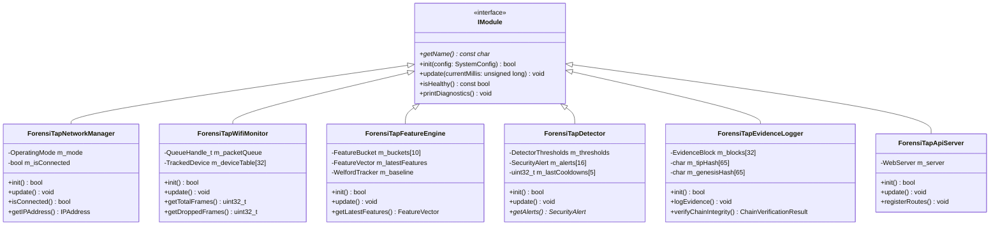
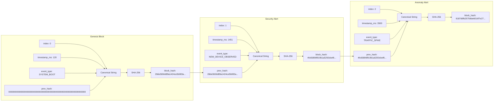
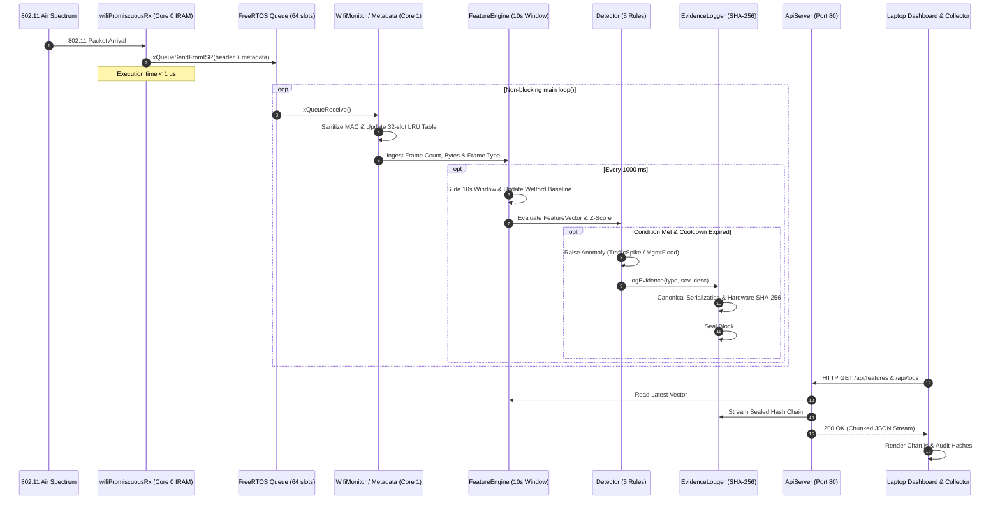

# ForensiTap-ESP32: Complete System Architecture Manual

**Academic Title:** ForensiTap-ESP32: A Low-Cost Wireless Network Monitoring, Anomaly Detection and Tamper-Evident Forensic Logging System  
**Document Classification:** Technical Architecture Reference & Subsystem Specification  

---

## 1. Physical Hardware & Silicon Architecture

The edge appliance runs on the **Espressif ESP32-WROOM-32** system-on-chip (SoC) packaged within a DOIT ESP32 DevKit V1 board:

```text
+---------------------------------------------------------------------------------+
|                               ESP32-WROOM-32 SoC                                |
|                                                                                 |
|  +-----------------------------------+   +-----------------------------------+  |
|  |     Core 0 (Protocol CPU / PRO)    |   |    Core 1 (Application CPU / APP) |  |
|  |           Xtensa LX6 @ 240 MHz    |   |           Xtensa LX6 @ 240 MHz    |  |
|  |                                   |   |                                   |  |
|  |  * FreeRTOS Wi-Fi System Tasks    |   |  * Main loop() Non-Blocking Loop  |  |
|  |  * Promiscuous RX ISR Callback    |   |  * Feature Extraction Engine      |  |
|  |  * 802.11 Hardware MAC/Baseband   |   |  * Deterministic Anomaly Detector |  |
|  |  * TCP/IP Ingress/Egress          |   |  * SHA-256 Hash Chaining          |  |
|  +-----------------------------------+   +-----------------------------------+  |
|                    ^                                       ^                    |
|                    |             Inter-Core Bus            |                    |
|                    +-------------------+-------------------+                    |
|                                        |                                        |
|  +-------------------------------------+-------------------------------------+  |
|  |                            Internal SRAM                                  |  |
|  |  * 520 KB Total Physical SRAM                                             |  |
|  |  * 328 KB Dynamic DRAM Pool (Nominal Free: > 208 KB)                       |  |
|  |  * IRAM: Sub-microsecond RX ISR Callback & Critical Interrupt Routines     |  |
|  +-------------------------------------+-------------------------------------+  |
|                                        |                                        |
|  +-------------------------------------+-------------------------------------+  |
|  |                         Peripherals & Hardware Crypto                     |  |
|  |  * Hardware Accelerated SHA-256 Engine (mbedTLS alt)                      |  |
|  |  * 2.4 GHz 802.11 b/g/n RF Frontend & Baseband (Channels 1 - 14)          |  |
|  |  * Silicon UART0 (115200 baud Serial Diagnostics)                         |  |
|  |  * 4 MB External SPI Flash (Program Partition: 1.31 MB, Used: 72.3%)       |  |
|  +---------------------------------------------------------------------------+  |
+---------------------------------------------------------------------------------+
```

### Key Silicon Allocations:
- **Core 0 (PRO CPU):** Dedicated to handling time-critical hardware interrupts, radio baseband processing, the Wi-Fi PHY stack, and the sub-microsecond promiscuous RX interrupt service routine (`IRAM_ATTR`).
- **Core 1 (APP CPU):** Dedicated to running application-level tasks: the modular non-blocking task dispatcher, frame metadata extraction, 10-second sliding-window statistics, deterministic rule evaluations, SHA-256 evidence block minting, and the REST HTTP WebServer.
- **Hardware Crypto Acceleration:** Leverages the ESP32's on-chip symmetric crypto engine (`mbedtls_sha256`), reducing 256-byte hash calculation latency to under $25\,\mu\text{s}$, completely eliminating CPU stalling during network sniffing.

---

## 2. Firmware Operating Model & Modular Lifecycle

To prevent the common pitfalls of embedded C/C++ projects (such as spaghetti code, unbounded memory growth, and heap fragmentation), ForensiTap enforces a strict object-oriented lifecycle contract.



### Subsystem Registration & Execution Order:
In `ForensiTap.ino`, all subsystems are registered into a central array of pointers (`IModule* g_modules[MAX_MODULES]`) and initialized in dependency order:
1. `g_networkManager` (Establishes Wi-Fi station connectivity and DHCP IP assignment).
2. `g_wifiMonitor` (Initializes FreeRTOS queue, registers IRAM promiscuous callback, and configures hardware packet filter).
3. `g_featureEngine` (Initializes 10-second sliding-window circular buckets and Welford baseline statistics).
4. `g_detector` (Initializes deterministic security rules, alert ring buffer, and cooldown timers).
5. `g_evidenceLogger` (Mints Genesis Block #0 and initializes SHA-256 hash chain).
6. `g_apiServer` (Registers REST routes and begins listening on HTTP port 80).

---

## 3. Single 2.4 GHz Radio Coexistence Architecture

A major technical challenge in low-cost IoT monitoring is operating a promiscuous packet sniffer on an ESP32 while simultaneously maintaining a TCP/IP network connection to host a REST API.

```text
                      IEEE 802.11 2.4 GHz Spectrum
                                   |
                  +----------------+----------------+
                  |  Wi-Fi Radio Transceiver (RF)   |
                  |     Locked to Channel 11        |
                  +----------------+----------------+
                                   |
                   Espressif Wi-Fi MAC Hardware Layer
                                   |
         +-------------------------+-------------------------+
         |                                                   |
         v                                                   v
[Station Network Stack]                           [Promiscuous Monitor Tap]
- Assoc with AP (192.168.1.26)                    - Hardware Filter (Mgmt + Data)
- TCP/IP Stack (LwIP)                             - Sub-microsecond IRAM Callback
- WebServer (Port 80 HTTP)                        - Extracts Raw Frame Headers
- Serves Dashboard & API queries                  - Pushes to FreeRTOS Queue (64 slots)
```

### Coexistence Mechanism:
1. **Station Association:** The device connects to the user's local Access Point on **Channel 11** (`g_config.defaultWifiChannel = 11`), obtaining IP `192.168.1.26`.
2. **Promiscuous Mode Activation:** Promiscuous mode (`esp_wifi_set_promiscuous(true)`) is enabled with filter masks `WIFI_PROMIS_FILTER_MASK_MGMT | WIFI_PROMIS_FILTER_MASK_DATA`.
3. **Channel Locking:** Because both the Station connection and the sniffer share Channel 11, the Station connection remains completely uninterrupted while the sniffer intercepts all ambient frames on that frequency.
4. **Zero Collisions:** Outgoing HTTP responses and incoming sniffer frames are multiplexed seamlessly by the underlying Espressif baseband scheduler.

---

## 4. Zero-Dynamic-Allocation Memory Architecture

To ensure indefinite operational stability without memory fragmentation, ForensiTap strictly adheres to a **zero runtime heap allocation** design rule. All internal data structures are statically dimensioned at compile time:

```text
+-------------------------------------------------------------------------------+
|                       STATIC MEMORY STRUCTURE MAP                             |
|                                                                               |
| 1. FreeRTOS Frame Ingestion Queue                                             |
|    - Capacity : 64 Packet Slots                                               |
|    - Memory   : 64 * 32 bytes = 2,048 bytes (IRAM/DRAM safe)                  |
|    - Purpose  : Decouples sub-microsecond ISR from main loop processing        |
|                                                                               |
| 2. LRU Active Device Tracking Table                                           |
|    - Capacity : 32 Tracked Entities                                           |
|    - Memory   : 32 * 36 bytes = 1,152 bytes                                   |
|    - Purpose  : Tracks unique MACs, roles (AP/STA), packets, RSSI, timestamps  |
|                                                                               |
| 3. Sliding Window Feature Engine                                              |
|    - Capacity : 10 Circular 1-second Buckets                                  |
|    - Memory   : 10 * 24 bytes = 240 bytes                                     |
|    - Purpose  : Computes 10s windowed rates without keeping millions of pkts  |
|                                                                               |
| 4. Deterministic Alert Ring Buffer                                            |
|    - Capacity : 16 Security Alert Slots                                       |
|    - Memory   : 16 * 108 bytes = 1,728 bytes                                  |
|    - Purpose  : Stores recent anomalies with 30s cooldown deduplication       |
|                                                                               |
| 5. Cryptographic Evidence Chain Window                                        |
|    - Capacity : 32 Forensic Block Records                                     |
|    - Memory   : 32 * 254 bytes = 8,128 bytes                                  |
|    - Purpose  : In-memory window of SHA-256 sealed tamper-evident blocks      |
+-------------------------------------------------------------------------------+
```

### Heap Health Verification:
- **Total Static RAM Allocated:** $\approx 59.2\,\text{KB}$ ($18.1\%$ of $328\,\text{KB}$ DRAM).
- **Available Free Heap at Runtime:** Consistently **$> 208\,\text{KB}$** ($> 63\%$ available).
- **Stress Drift:** Multi-threaded stress testing (70 requests @ 11.9 req/s) showed a drift of only $-1.83\%$, reflecting normal TCP socket buffer recycling with zero memory leaks.

---

## 5. Cryptographic Evidence Hash Chain Model

The forensic subsystem implements an immutable, append-only cryptographic directed acyclic graph (DAG) modeled after a lightweight single-branch blockchain:



### Mathematical Formulation:
1. **Canonical Pipe Serialization:**
   $$\text{Canonical}_i = \text{index}_i \parallel "|" \parallel \text{timestamp\_ms}_i \parallel "|" \parallel \text{event\_type}_i \parallel "|" \parallel \text{severity}_i \parallel "|" \parallel \text{description}_i \parallel "|" \parallel \text{prev\_hash}_i$$

2. **State Transition Rule:**
   $$\text{prev\_hash}_0 = \text{"0"}^{64}$$
   $$\text{block\_hash}_i = \text{SHA-256}(\text{Canonical}_i)$$
   $$\text{prev\_hash}_{i+1} = \text{block\_hash}_i \quad \forall i \ge 0$$

3. **Tamper Proof:**
   If an adversary modifies any byte in block $k$ ($description_k \to description_k'$):
   $$\text{SHA-256}(\text{Canonical}_k') \neq \text{block\_hash}_k$$
   If the adversary updates $block\_hash_k$ to match the tampered payload, then in block $k+1$:
   $$\text{prev\_hash}_{k+1} \neq \text{block\_hash}_k'$$
   The hash chain immediately breaks and is flagged by both on-chip and laptop audit tools.

---

## 6. REST API & Chunked HTTP Streaming Architecture

The API server (`ForensiTapApiServer`) runs on port 80. To stream large JSON arrays (such as 32 tracked devices or 32 forensic evidence blocks) without allocating multi-kilobyte buffers in RAM, it employs **HTTP Chunked Transfer Encoding**:

```cpp
void ForensiTapApiServer::handleLogs() {
    setCorsHeaders();
    m_server.setContentLength(CONTENT_LENGTH_UNKNOWN);
    m_server.send(200, "application/json", "");

    m_server.sendContent("{\"total_blocks\":X,\"blocks\":[");
    for (int i = 0; i < count; ++i) {
        snprintf(blockBuf, sizeof(blockBuf), ...);
        m_server.sendContent(blockBuf);
    }
    m_server.sendContent("]}");
    m_server.sendContent(""); // Final empty chunk closes HTTP body
}
```

### Security & CORS:
All responses include:
- `Access-Control-Allow-Origin: *`
- `Access-Control-Allow-Methods: GET, POST, OPTIONS`
- `Access-Control-Allow-Headers: Content-Type, Authorization`
This allows any web dashboard loaded from `file:///` or `http://localhost:8080` to communicate directly with the ESP32 without browser security blocking.

---

## 7. Host Workstation & Machine Learning Architecture

The host workstation complements the embedded sensor with data visualization, continuous streaming collection, forensic traffic analytics, and multi-dimensional machine learning:

```mermaid
flowchart TD
    ESP[ESP32 Appliance (192.168.1.26)]

    subgraph Host Software Architecture [Laptop Workstation]
        subgraph Real-Time UI
            DASH_SERVER[dashboard/server.py (Port 8080)]
            DASH_CLIENT[dashboard/app.js (Chart.js Engine)]
            DASH_SERVER --> DASH_CLIENT
        end

        subgraph Ingestion & Storage
            COLL[laptop/collector/collector.py]
            STORAGE[(datasets/sessions/session_YYYYMMDD_HHMMSS/)]
            COLL -->|telemetry.jsonl<br/>devices.jsonl<br/>evidence_chain.jsonl| STORAGE
        end

        subgraph Forensic Analysis
            ANALYTICS[laptop/analytics/traffic_analysis.py]
            STORAGE --> ANALYTICS
            ANALYTICS --> SUMMARY[analysis_summary.json & ASCII Report]
        end

        subgraph Machine Learning Pipeline
            TRAIN[laptop/ml/train.py]
            MODEL[(laptop/ml/models/forensitap_anomaly_model.json)]
            INFER[laptop/ml/inference.py]
            
            STORAGE --> TRAIN --> MODEL
            MODEL --> INFER
            ESP -->|Live Streaming Telemetry| INFER
        end
    end

    ESP <-->|Async REST Fetch| DASH_CLIENT
    ESP -->|Fault-Tolerant Polling| COLL
```

### Host Machine Learning Pipeline (Stage 17):
- **Feature Space:** 7-dimensional vectors from ESP32 (`frame_rate`, `byte_rate`, `avg_frame_size`, `peers`, `mgmt_ratio`, `burst_score`, `z_score`).
- **Robust Scaler:** Calculates Medians and Median Absolute Deviations (MAD), resisting outlier contamination.
- **Weighted Distance:** Computes multidimensional Mahalanobis distance with heavy weighting on attack indicators ($w_{\text{mgmt}} = 2.0$, $w_{\text{burst}} = 1.8$, $w_Z = 1.5$).
- **Sigmoid Mapping:** Converts distance into an intuitive anomaly probability ($0.0$ to $1.0$).
- **Explainability:** Identifies the physical feature driving the anomaly (e.g. $+18.1\,Z$ management frame ratio).

---

## 8. End-to-End Packet Processing Sequence


