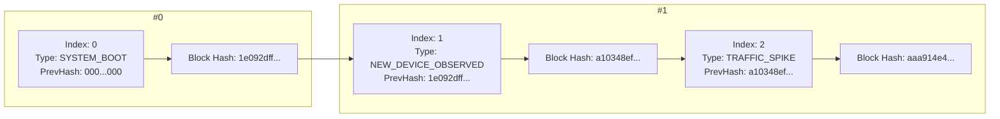

# ForensiTap-ESP32: Cryptographic Tamper-Evident Forensic Logging

## 1. Overview

In digital forensics and incident response, evidence admissible in an audit or legal proceeding must demonstrate **chain of custody** and **tamper resistance**. If log records stored on or streamed from an embedded IoT sensor can be quietly altered, truncated, or forged, the integrity of the forensic investigation is compromised.

The **Forensic Evidence Logging Subsystem** (`ForensiTapEvidenceLogger`, module code `EVID`) solves this on the ESP32 by implementing a cryptographic **hash chain** (an append-only, lightweight directed acyclic graph). Every system boot, network state transition, detected anomaly, and physical tamper event is formatted into a canonical data structure, combined with the SHA-256 digest of the immediately preceding block, and sealed using hardware-accelerated SHA-256 hashing.

---

## 2. Cryptographic Block Structure & Chaining



### Canonical Serialization
To guarantee deterministic cryptographic hashes across disparate platforms (ESP32 C++ and Laptop Python), each block is normalized into a strict canonical pipe-delimited format prior to hashing:

$$\text{Canonical String} = \text{index} \parallel "|" \parallel \text{timestamp\_ms} \parallel "|" \parallel \text{event\_type} \parallel "|" \parallel \text{severity} \parallel "|" \parallel \text{description} \parallel "|" \parallel \text{prev\_hash}$$

$$\text{Block Hash} = \text{SHA-256}(\text{Canonical String})$$

- **Genesis Block ($i = 0$):** Sealed at boot. Its `prev_hash` is predefined as 64 hex zeros (`0000000000000000000000000000000000000000000000000000000000000000`).
- **Sequential Blocks ($i \ge 1$):** Sealed dynamically on security alerts or state transitions. `prev_hash` is strictly set to the `block_hash` of block $i-1$.

---

## 3. Mathematical Tamper Resistance

If an adversary gains write access to memory or network transit:
1. **Payload Modification:** If an adversary modifies `description` (e.g. altering an observed attacker MAC to all zeros), recalculating $\text{SHA-256}(\text{Canonical})$ will not match `block_hash`.
2. **Hash Forgery:** If the adversary recalculates `block_hash` for block $i$, block $i+1$'s `prev_hash` will no longer match block $i$'s new hash, breaking the chain.
3. **Record Deletion:** If block $i$ is removed, the sequence index discontinuity ($index_{i+1} \neq index_{i-1} + 1$) and broken link ($prev\_hash_{i+1} \neq block\_hash_{i-1}$) immediately flag the deletion.

---

## 4. Hardware Optimization & Memory Footprint

- **Hardware Acceleration:** ESP32 hardware cryptographic engine is leveraged via `mbedtls_sha256()`. A 256-byte hash calculation takes $< 25\,\mu\text{s}$, executing seamlessly in the main loop without dropping promiscuous Wi-Fi frames.
- **Bounded Sliding Memory Window:** 32 fixed `EvidenceBlock` slots in static RAM (`~8 KB` total), avoiding dynamic heap fragmentation.
- **Tip Hash Preservation:** Even if old blocks scroll out of the 32-slot active RAM window, `m_tipHash` and `m_genesisHash` are permanently preserved to retain cryptographic continuity.

---

## 5. REST API Interface

### Endpoint: `GET /api/logs`
Returns the recent evidence chain blocks as a streamed JSON payload.

```json
{
  "chain_valid": true,
  "total_blocks": 21,
  "stored_count": 16,
  "genesis_hash": "1e092dff1bc036437d0c329...",
  "tip_hash": "aaa914e4981ffdac5e913a...",
  "blocks": [
    {
      "index": 0,
      "timestamp_ms": 120,
      "event_type": "SYSTEM_BOOT",
      "severity": "INFO",
      "description": "Genesis block: ForensiTap evidence chain initialized",
      "prev_hash": "0000000000000000000000000000000000000000000000000000000000000000",
      "block_hash": "1e092dff1bc036437d0c32906e57936a..."
    }
  ]
}
```

### Endpoint: `GET /api/logs/verify`
Executes an on-chip mathematical audit of the in-memory hash chain.
```json
{
  "status": "VALID",
  "chain_intact": true,
  "blocks_checked": 16,
  "total_blocks_created": 21,
  "failed_index": 0,
  "failure_reason": "",
  "genesis_hash": "1e092dff1bc036437d0c329...",
  "tip_hash": "aaa914e4981ffdac5e913a..."
}
```

---

## 6. Laptop Independent Verification Script

The laptop verification utility is located at `laptop/verification/verify_logs.py`:

```bash
# Query and independently audit live ESP32 evidence chain
python laptop/verification/verify_logs.py --url http://192.168.1.26/api/logs

# Audit an exported JSON evidence file
python laptop/verification/verify_logs.py --file evidence_export.json

# Run simulated tamper demonstration
python laptop/verification/verify_logs.py --tamper-demo
```
