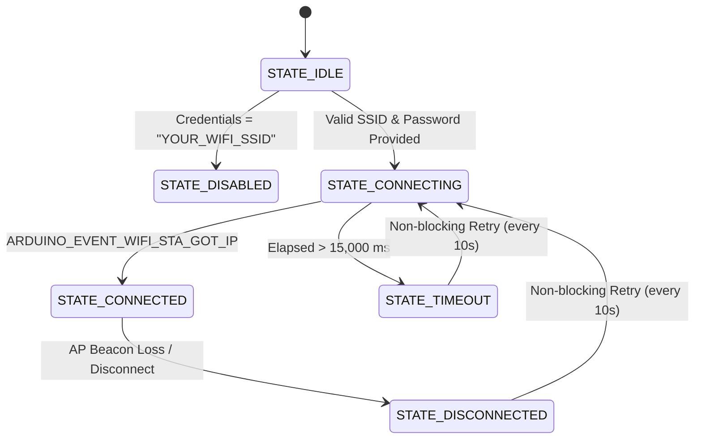

# Stage 6: Wi-Fi Initialization & Network Management

## 1. Overview

**Stage 6** introduces the **`NetworkManager`** subsystem (`firmware/main/network_manager.cpp` and `network_manager.h`), responsible for establishing and maintaining Wi-Fi station connectivity for the **ForensiTap-ESP32** appliance.

The network manager enables the appliance to join a 2.4 GHz wireless network to host the REST HTTP API and Dashboard (Stages 7 and 13), stream real-time forensic telemetry to the host workstation, and synchronize timestamps.

---

## 2. Hardware Radio Constraints & Coexistence Analysis

### 2.1 The Single-PHY Reality of the ESP32
The ESP32 features a **single physical 2.4 GHz RF transceiver** and baseband processor. It does **not** have two separate radios.

```
       +-----------------------------------------------------------+
       |             ESP32 Single 2.4 GHz Radio Frontend           |
       +-----------------------------------------------------------+
                                     |
               +---------------------+---------------------+
               |                                           |
               v                                           v
   [ Station Mode (WIFI_STA) ]                 [ Promiscuous Sniffer ]
   - Associated to specific AP                 - Raw frame interception
   - Locked to AP's Channel                    - Receives all 802.11 frames
   - TCP/IP Stack Active                       - Bypasses TCP/IP stack
```

### 2.2 Operational Coexistence Rules
1. **Channel Locking in Station Mode:**
   When the ESP32 associates as a station (`WIFI_STA`) to your Wi-Fi router or hotspot, its hardware radio synthesizer is locked to that router's channel (e.g., Channel 1, 6, or 11).
2. **Impact on Promiscuous Capture:**
   - In **Connected Mode (`MODE_CONNECTED`)**, promiscuous frame sniffing can only observe packets broadcast or transmitted on the **same channel** as the connected station network.
   - If the ESP32 were to hop channels while connected, the Wi-Fi connection to the router would drop (resulting in `BEACON_TIMEOUT` or deassociation).
3. **Dedicated Monitor Mode (`MODE_PROMISCUOUS`):**
   When the appliance needs to audit or scan across other channels (hopping), it must either cycle through a dedicated sniffing interval or operate in standalone capture mode.

---

## 3. Architecture & Non-Blocking Design

### 3.1 Event-Driven Asynchronous Lifecycle
Rather than using blocking loops like `while (WiFi.status() != WL_CONNECTED) delay(500);`, `NetworkManager` leverages the underlying ESP32 FreeRTOS event loop:
- `WiFi.onEvent(NetworkManager::onWifiEvent)` registers an asynchronous callback.
- The Wi-Fi driver dispatches events independently on Core 0 (`WIFI_TASK`), updating internal state atomically without blocking the main telemetry loop on Core 1 (`app_main`).

### 3.2 State Machine
The subsystem cycles through deterministic states:



---

## 4. Configuration Instructions

### 4.1 Safe Credential Management (`wifi_credentials.h`)
To prevent accidental leakage of sensitive credentials in version control, network credentials are isolated in `firmware/main/ForensiTap/wifi_credentials.h`:

```cpp
// Replace with your 2.4 GHz Wi-Fi network SSID (ESP32 only supports 2.4 GHz)
#define WIFI_SSID "YOUR_WIFI_SSID"

// Replace with your Wi-Fi WPA2/WPA3 password
#define WIFI_PASSWORD "YOUR_WIFI_PASSWORD"
```

> [!IMPORTANT]
> - The ESP32 hardware radio **only supports 2.4 GHz Wi-Fi** (802.11 b/g/n). It **cannot** connect to 5 GHz-only networks.
> - If you use a dual-band home router with separate 2.4 GHz and 5 GHz networks, select the 2.4 GHz SSID.
> - If left as `"YOUR_WIFI_SSID"`, `NetworkManager` gracefully disables Wi-Fi negotiation and continues operating safely in `MODE_STANDALONE` without hangs.

---

## 5. Verification & Test Procedures

### Test Case A: Unconfigured Credentials (Graceful Standalone Fallback)
1. Leave `WIFI_SSID` as `"YOUR_WIFI_SSID"`.
2. Compile and upload the sketch.
3. **Expected Serial Output:**
   ```text
   [      1054] [INFO ] [SYS ] Subsystem [NET] initialization SUCCESS
   [      1055] [WARN ] [NET ] Credentials unconfigured (WIFI_SSID='YOUR_WIFI_SSID').
   [      1055] [INFO ] [NET ] To connect, update 'wifi_credentials.h' with your 2.4 GHz network.
   ```
   The appliance does not hang and continues emitting heartbeats with status `WIFI_OFFLINE`.

### Test Case B: Successful Association & DHCP Lease
1. Edit `wifi_credentials.h` with your valid 2.4 GHz SSID and password.
2. Compile and upload.
3. Open Serial Monitor at **115200 baud**.
4. **Expected Serial Output:**
   ```text
   [      1054] [INFO ] [SYS ] Subsystem [NET] initialization SUCCESS
   [      1055] [INFO ] [NET ] Initiating non-blocking connection to SSID: [HomeNetwork]...
   [      1850] [INFO ] [NET ] Associated with AP. Negotiating DHCP IP lease...
   [      2920] [INFO ] [NET ] DHCP Lease Granted! IPv4: 192.168.1.145 | Channel: 6 | RSSI: -54 dBm
   [      4000] [INFO ] [LIV ] [HEARTBEAT] ForensiTap is running | WIFI_CONNECTED | Uptime: 4 s | Heap: 284112 B

   ---------------- [SYSTEM TELEMETRY REPORT] ----------------
   Uptime           : 10000 ms (10 sec)
   Operating State  : Mode 2 | Health: OPTIMAL
   Memory Available : 284112 bytes dynamic heap
   Events Processed : 1 logged
   Frames Ingested  : 0 frames | 0 dropped
   ----------------------------------------------------------
     +-- [Network Manager Subsystem: NET]
     |   State           : CONNECTED
     |   Station MAC     : 24:6F:28:XX:XX:XX
     |   IPv4 Address    : 192.168.1.145
     |   Subnet Mask     : 255.255.255.0
     |   Gateway         : 192.168.1.1
     |   Active Channel  : 6
     |   Signal RSSI     : -54 dBm
     +------------------------------------
   ```

### Test Case C: Connection Timeout & Non-Blocking Recovery
1. Configure an unreachable SSID (e.g., `"NonExistentSSID"`).
2. The firmware waits 15 seconds, detects timeout, logs:
   `[WARN] [NET ] Connection attempt timed out after 15000 ms`
3. The heartbeat never stops executing. Every 10 seconds, it non-blockingly retries:
   `[INFO] [NET ] Auto-reconnect attempt #1 to [NonExistentSSID]...`
